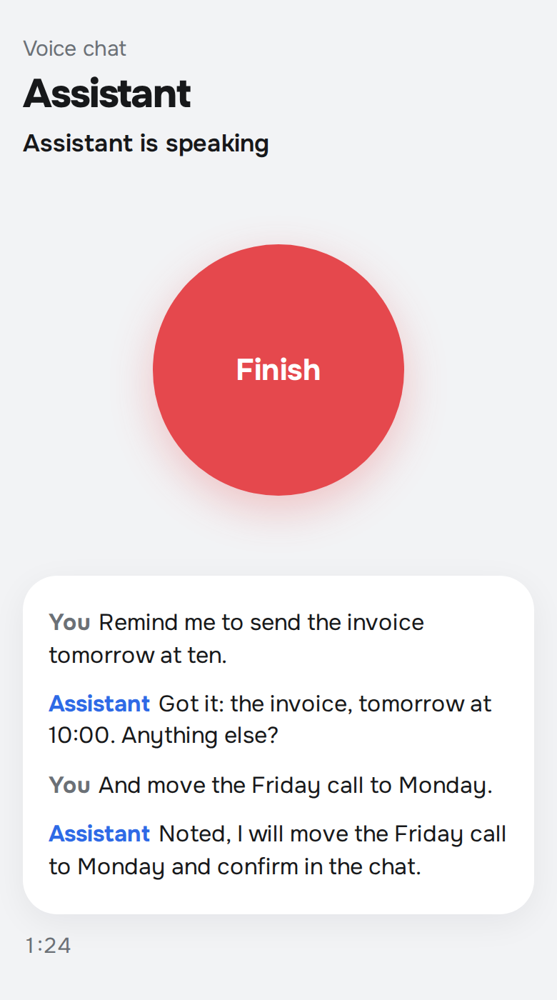

# tg-voice-assistant — talk to your AI assistant by voice inside Telegram

A Telegram Mini App with one big button: tap, speak, and the assistant answers out loud with live subtitles.
Audio goes straight from the phone to the OpenAI Realtime API over WebRTC, so the reply starts in under a second
and you can interrupt it mid-sentence. When you finish, the transcript is saved and your own backend can pick it up
and act on it (create tasks, reply in the chat). I use it as the voice front door to my personal assistant.



## How it works

```
Telegram Mini App ──(initData)──► FastAPI: verify HMAC + owner id ──► OpenAI: 120-second client secret
        │                                                                     │
        └────────────── WebRTC audio + data channel ◄────────────────────────┘
        │
        └──► POST /api/transcript ──► transcripts.jsonl ◄── GET /api/transcripts (your backend, X-Api-Token)
```

- **Auth.** Telegram `initData` is checked with HMAC-SHA256 keyed by the bot token, must be fresher than 24 h and
  belong to `OWNER_TG_ID`. Everyone else gets 403. The OpenAI key stays on the server; the browser gets an ephemeral
  secret valid for two minutes.
- **Session.** Server-side VAD (500 ms of silence ends a turn), barge-in enabled, `gpt-4o-mini-transcribe` for the
  user's side, any Realtime voice for the reply. If the user stays silent for 1.5 s the assistant greets first.
- **Context.** Your backend can `POST /api/notes` with up to 20k characters (today's tasks, calendar, open questions);
  they are appended to the instructions of every new session.
- **Transcripts.** Saved once per session id (safe on retries and `pagehide`), pulled incrementally with `?after=<id>`.

## Run

```bash
cp .env.example .env        # BOT_TOKEN, OWNER_TG_ID, OPENAI_API_KEY, API_TOKEN
pip install -r requirements.txt
uvicorn app:app --port 8080
```

Deploy anywhere with HTTPS (a `Procfile` is included for Railway/Heroku-style hosts), then in BotFather set the
bot's Mini App / menu button URL to your domain. Open it from the bot on your phone and allow the microphone.

## License

MIT
